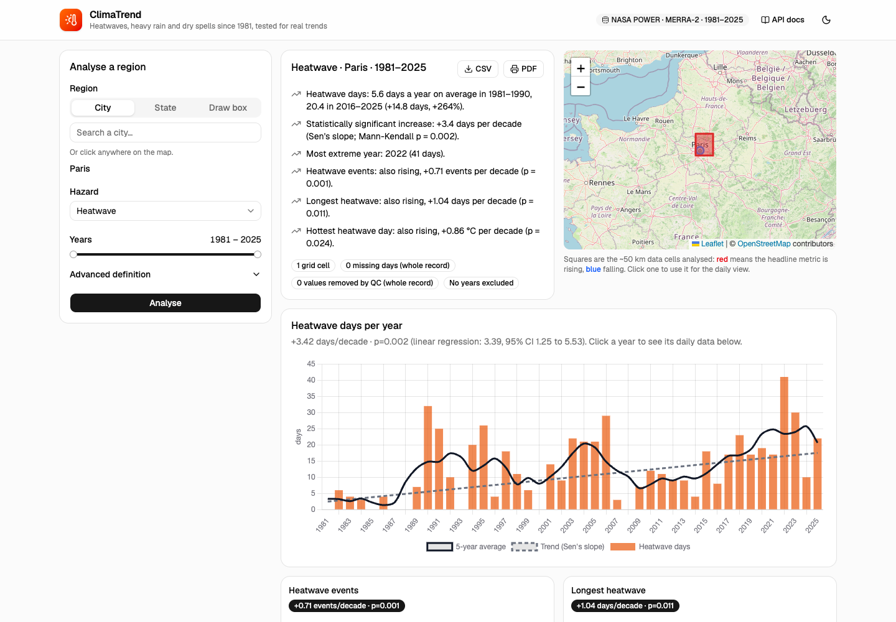

# ClimaTrend: Climate Hazard Trend Analyzer

Pick a city, a state or a box on the map, and see how heatwaves (or heavy rain, or dry spells) have changed there since 1981, with an honest test of whether the change is real.

**Live app:** _TODO: Vercel URL_ · **API:** _TODO: Render URL_ (free tier: the first request after idle takes ~50 s to wake up)



## What it does

- **Region:** city search, state/province search (with its outline), click on the map, or draw a box.
- **Hazard:** Heatwave by default, plus Heavy rain and Drought (dry spells).
- **Years:** any range of at least 10 years between 1981 and the last complete year.
- **Output:**
  - Insights in plain English ("+3.4 heatwave days per decade, Mann-Kendall p = 0.002").
  - Yearly charts with a 5-year average and trend line.
  - One small chart per secondary metric.
  - A map of the analysed grid cells coloured by trend.
  - Click a year to see its daily temperatures against the threshold, with each event shaded.
- **Export:** CSV of the yearly table, and PDF through the browser's print dialog.
- **Shareable links:** the page URL holds the full query.

## Run it locally

Needs Python 3.12 + [uv](https://docs.astral.sh/uv/), Node ≥ 20.19, and MongoDB (Docker is easiest).

```bash
docker run -d --name climate-mongo -p 27017:27017 mongo:8

cd backend
uv sync
uv run uvicorn app.main:app --reload          # http://localhost:8000/docs
uv run pytest                                 # hazard + trend tests
uv run python seed.py                         # optional: pre-download demo cities

cd ../frontend
npm install
npm run dev                                   # http://localhost:5173
```

Environment variables (all optional locally):

| Variable | Where | Default |
|---|---|---|
| `MONGO_URI` | backend | `mongodb://localhost:27017` |
| `ALLOWED_ORIGINS` | backend | `http://localhost:5173` (comma-separated) |
| `VITE_API_URL` | frontend | `http://localhost:8000` |

## Architecture

```
React + Vite (Vercel) ──GET──> FastAPI (Render, Docker) ──> MongoDB Atlas
  Chart.js, Leaflet,             validation, rate limits      weather_daily  (raw data, permanent)
  TanStack Query                 │                            analyses       (results, 7-day TTL)
                                 │                            places         (state outlines, 30-day TTL)
                                 ├─> NASA POWER daily API   (weather)
                                 ├─> Open-Meteo geocoding   (city search)
                                 └─> Nominatim / OSM        (state search + outline)
```

What happens on `GET /api/analysis`:

1. **Cache check.** Look up the request (normalised, plus an algorithm version) in `analyses`. On a hit, return it (~60 ms).
2. **Grid cells.** Turn the region into grid cells:
   - A city or clicked point becomes 1 cell.
   - A box or state becomes up to 9 cells spread over it, keeping only cells whose centre is inside the state outline.
3. **Daily data.** Load each cell's daily data from `weather_daily`.
   - Missing cells are downloaded from NASA POWER: 45 years in one call, ~2 s.
   - A per-cell lock means simultaneous requests share one download.
4. **QC, then detection.** Run quality control, then hazard detection, **per cell**.
5. **Combine.** Average the yearly metrics across cells, fit trends, and write the insights.
6. **Store and return.** Save the result to `analyses` and return it.

| Backend file | What's in it |
|---|---|
| `app/main.py` | HTTP layer: request models and validation, rate limits, caching headers, CSV export |
| `app/analysis.py` | The flow above: region → cells → data → regional result |
| `app/hazards.py` | QC and hazard detection. Pure functions, no I/O |
| `app/trends.py` | Rolling mean, regression, Mann-Kendall / Sen's slope, insight sentences |
| `app/sources.py` | NASA POWER, Open-Meteo and Nominatim clients (retry, backoff, politeness limits) |
| `app/store.py` | MongoDB collections |

The frontend has no hazard-specific code. `/api/meta` lists the hazards and the parameters each one uses, and every analysis response carries its own metric labels and units. Adding a hazard is one function and one entry in `HAZARDS` in `hazards.py`.

## Data source

**NASA POWER daily point API**: MERRA-2 reanalysis, a 0.5° × 0.625° grid (~50 km), 1981 to present, no API key.

- **Variables:** daily max and min 2 m temperature, and bias-corrected precipitation.
- **Why not Open-Meteo (the original plan):** I tested its archive API first. One 44-year daily request for a single location used up the whole free per-minute quota, and the second request got `429 Minutely API request limit exceeded`. Open-Meteo counts long requests as many calls, so the free tier allows roughly 8 new locations a day. NASA POWER returned three back-to-back 45-year downloads in ~2 s each with no throttling.
- **Trade-offs of NASA POWER:**
  - No data before 1981.
  - A coarser grid. Reanalysis smooths local extremes, so a weather station would record more hot days than the grid cell. Trends are more reliable than absolute counts.
- **Geocoding:**
  - Open-Meteo for cities, which is cheap and generous.
  - Nominatim for states, because it returns the outline polygon. Its policy of at most 1 request a second is enforced with a lock.

## Hazard logic

### Heatwave (default)

**Definition:** at least 3 consecutive days with daily max temperature above the 95th percentile, as in the brief.

- **The percentile comes from a fixed 1981–2010 baseline, not from the years you select.** If the threshold were computed from the selected years, it would move whenever you changed the range. A warming period would also partly define its own "normal" and hide part of its own trend.
- **Two ways to compute the threshold** (Advanced → "Threshold compared against"):
  - **Whole year (default).** One threshold: the 95th percentile of all baseline days. Only the hot season can cross it, which matches what people mean by a heatwave.
  - **Same time of year.** A separate 95th percentile for each calendar day, from a 15-day window (the ETCCDI approach). This also catches unusually warm spells in winter.
- **Yearly metrics** (after Perkins & Alexander 2013):
  - Heatwave days (the headline)
  - Number of events
  - Longest event
  - Mean °C above the threshold
  - Hottest heatwave day
- An event that crosses New Year counts toward the year it started in.
- **Regions with several cells:** heatwaves are detected in **each cell separately**, then the yearly metrics are averaged. Averaging the temperatures first would smooth away the extremes we're trying to find.

### Heavy rain

- Days with rainfall above the 95th percentile of baseline **wet** days (≥ 1 mm). This is the R95p idea.
- Reported per year: number of such days, events, rain falling on those days, and the wettest day.

### Drought (proxy)

- Dry day = under 1 mm of rain.
- Reported per year: the longest dry spell, the number of spells of 30 days or more, and annual rainfall compared with the 1981–2010 average.
- A real drought index (SPI/SPEI) needs evapotranspiration and a fitted distribution. That's out of scope, so the label says "dry spells".

## Trends and insights

- **Trend test:** Mann-Kendall plus Sen's slope (`scipy.stats.kendalltau` and `theilslopes`), reported per decade. These are rank-based, so one extreme year can't drag the result around, and they make no assumption about how counts are distributed. Ordinary least-squares regression with a 95% confidence interval is returned as well.
- **"Significant" means p < 0.05.** The test assumes years are independent, and climate series are mildly autocorrelated, so p-values near 0.05 are borderline.
- **Insight sentences follow fixed rules so they stay honest:**
  - They compare the **first-decade average with the last-decade average**, never two single years.
  - Percent change is shown only for counts, and only when the starting value is at least 1 a year. "+300%" from 0.5 to 2 days misleads.
  - Every trend sentence states whether it is statistically significant. If it isn't, it says so.
  - A caveat appears when fewer than 20 years are selected, and when years were excluded.
- **Example of why this matters:** Paris shows a significant +3.4 heatwave days per decade for 1981–2025 (p = 0.002), but **no trend for 1991–2020** (12.0 → 13.5 days a year, p = 0.83). The long-run signal comes from the cool 1980s and recent hot summers such as 2022 (41 days) and 2023. The tool reports both readings rather than picking one.

## Data handling

Quality control in `hazards.clean`. The results go back with every analysis and appear as badges in the UI.

- **Fill values:** NASA's `-999` becomes "missing".
- **Units:** asserted on every download (°C and mm/day). If NASA ever changed units, the app fails loudly instead of quietly treating Kelvin as °C.
- **Calendar:** the series is put on a gap-free daily calendar, with missing days left as missing (never filled in), and duplicates removed.
- **Plausibility bounds:** Tmax between −90 and 60 °C, Tmin ≤ Tmax, rain between 0 and 2,000 mm. Values outside are removed.
- **Outliers:** temperatures more than 6 standard deviations from the normal for that calendar day are removed. Rain is exempt, because heavy rain is supposed to be extreme.
- **A missing day ends a heatwave run** instead of being bridged over.
- **Incomplete years:** a year missing more than 5% of its days is left out of trends and shown as a gap. Counting it as zero would fake a decline. The current partial year is never used.
- **Raw values are stored before QC,** so changing a QC rule never needs a re-download.

## Security and performance

- **Input validation** (Pydantic):
  - Coordinate ranges, box at most 10° per side.
  - Years from 1981 to the last complete year, and at least 10 of them.
  - Percentile 80–99.9, minimum days 2–10.
  - Hazard must be a known name, state id must match `^[NWR]\d+$`, search text 2–80 characters.
  - Bad input returns 422 with a readable message.
- **No SSRF:** outbound URLs are fixed constants, and user input only ever goes into query parameters.
- **Rate limits per IP** (slowapi): analysis 20/min, place search 30/min, daily data 60/min. Uvicorn runs with `--proxy-headers` so the limiter sees the real client IP behind Render's proxy.
- **Being polite upstream:**
  - At most 3 concurrent NASA requests, and 1 Nominatim request per second.
  - Retries with exponential backoff on 429/5xx and network errors.
  - If the provider stays down, the API returns 502 with a friendly message and no stack trace.
- **Caching:**
  - Raw data in Mongo (permanent), finished analyses (7 days), state outlines (30 days).
  - Place searches carry `Cache-Control` for a day. Analyses deliberately don't: a browser-cached copy would outlive an `ALGO_VERSION` bump after a deploy.
  - In-browser caching via TanStack Query.
  - Responses are gzip-compressed.
- **CORS** allows only the frontend's origin and GET requests. Secrets live only in environment variables.

## Sanity checks against known events

| Event | What the app shows |
|---|---|
| Moscow 2010 heatwave | Top year by far: 49 heatwave days, including a 43-day event (5 Jul – 16 Aug) |
| Paris 2019 (record 42.6 °C) and 2003 | 2019 has the hottest heatwave day of 1981–2024, and 2003 is third |
| Mumbai floods, 26 July 2005 | 2005 is the top heavy-rain year |
| Chicago 1995 | **Not** a top year. That disaster was driven by humidity (heat index), which a Tmax-only definition misses. This is a known limitation, listed below |

## Assumptions

- "Heatwave" uses daily **max** temperature only, with no humidity or night-time minimum.
- A "state" is whatever OpenStreetMap tags as a state/province. Large states are represented by at most 9 sample cells.
- A city is analysed as the single grid cell containing it (~50 × 70 km), not the urban area itself.
- Boxes that cross the antimeridian aren't supported.

## What I would improve with more time

- **Heat stress:** add humidity (heat index / wet-bulb) and hot-night (Tmin) definitions. That would catch events like Chicago 1995.
- **Station data:** add station data (NOAA GHCN-Daily) as a second source, to compare against the reanalysis and show local extremes.
- **Drought:** use a proper SPI/SPEI drought index.
- **Statistics:**
  - Apply an autocorrelation correction to Mann-Kendall (Hamed–Rao).
  - Add a field-significance check when comparing many cells.
- **Cold-cache speed:** the first request for a big state waits for up to 9 downloads. Use a 202 + polling job for cold regions, and pre-warm popular states on a schedule.
- **Testing:** add API-level tests against a disposable Mongo, plus a Playwright smoke test of the UI.
- **Units:** a °F toggle. Insights are written server-side in °C, so they'd need to be produced in the chosen unit.

## API reference

Interactive docs are at `/docs` (FastAPI's OpenAPI UI).

| Endpoint | Purpose |
|---|---|
| `GET /api/meta` | Year range, hazards, and the parameters each hazard uses |
| `GET /api/places?q=&kind=city\|state` | Place search |
| `GET /api/analysis?hazard=&lat=&lon=` (or `bbox=s,w,n,e` or `state=`) `&start=&end=&percentile=&min_days=&method=` | Full analysis |
| `GET /api/analysis.csv?…` | Same parameters; the yearly table as CSV |
| `GET /api/daily?hazard=&lat=&lon=&year=…` | One year of daily values, threshold and events for one cell |

## AI tools used

_TODO (author): review and adjust this to match how you actually worked._

- **Claude Code (Claude Opus 5.5)** was used throughout as a pair programmer:
  - **Planning:** read the brief and proposed the architecture. I chose the stack, hazard scope and deployment target.
  - **Research:** checked API limits and found the Open-Meteo quota problem with a small test before any code was written.
  - **Code:** wrote the backend and frontend, with my review at each step.
  - **Testing:** drove a headless browser to click through the UI and check the print layout.
- Every hazard rule, statistical choice and insight wording was reviewed against the brief and checked on known events (table above).
