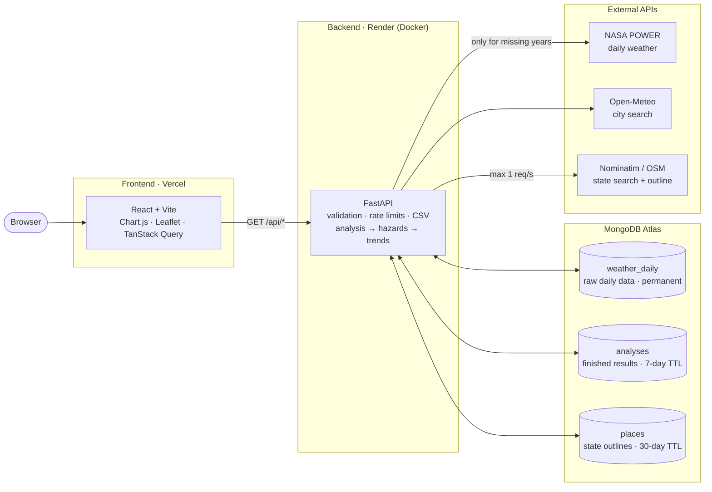

# ClimaTrend: Climate Hazard Trend Analyzer

Pick a city, a state or a box on the map, and see how heatwaves (or heavy rain, or dry spells) have changed there since 1981, with an honest test of whether the change is real.

**Live app:** https://climate-hazard-analyzer-sigma.vercel.app · **API docs:** https://climate-hazard-api-9ppo.onrender.com/docs

> The API runs on Render's free tier, which sleeps when idle: the first request after a quiet spell takes ~50 s while it wakes up.


## What it does

- **Region:** search a city, search a state/province (its outline is drawn on the map), click anywhere on the map, or draw a box by clicking two corners.
- **Hazard:** Heatwave by default, plus Heavy rain and Drought (dry spells).
- **Years:** any range of at least 10 years between 1981 and the last complete year.
- **Results:**
  - **Plain-English insights.** For example: "Statistically significant increase: +3.4 days per decade (Sen's slope; Mann-Kendall p = 0.002)."
  - **Headline chart:** bars per year, a 5-year average, and a Sen's-slope trend line. The linear-regression slope and its 95% confidence interval are shown alongside.
  - **One small chart per secondary metric,** each with a badge saying whether its trend is significant.
  - **Map** of the analysed grid cells, red if the headline metric is rising and blue if falling. Click a cell to use it for the daily view.
  - **Daily view.** Click a year to see its daily values against the threshold, with each event shaded. Switch between the whole year and a single month; the month list shows how many events touch each month.
  - **Data-quality line** at the bottom of the results card: number of grid cells, and "complete record" when nothing was wrong. Missing days, QC removals or excluded years show up there as badges (red for excluded years, since they change the trend).
- **Export:** CSV of the yearly table, and PDF through the browser's print dialog (with a print stylesheet).
- **Shareable links:** the page URL holds the full query.
- **Light and dark theme.** It follows the system setting and remembers your choice.

## Run it locally

Needs Python 3.12 + [uv](https://docs.astral.sh/uv/), Node ≥ 20.19, and MongoDB (Docker is easiest).

```bash
docker run -d --name climate-mongo -p 27017:27017 mongo:8   # mongodb://localhost:27017

cd backend
uv sync
uv run uvicorn app.main:app --reload          # http://localhost:8000/docs
uv run pytest                                 # hazard + trend tests
uv run python seed.py                         # optional: pre-download demo cities

cd ../frontend
npm install
npm run dev                                   # http://localhost:5173
```

Environment variables and more commands: [backend/README.md](backend/README.md) and [frontend/README.md](frontend/README.md).

## Deploy

1. **MongoDB Atlas:** create a free M0 cluster and a database user, and copy the `mongodb+srv://…` connection string.
2. **Render:** create a new Blueprint from this repo. `render.yaml` builds `backend/Dockerfile`. Set `MONGO_URI` to the Atlas string.
3. **Vercel:** import the repo with root directory `frontend`, and set `VITE_API_URL` to the Render URL.
4. **CORS:** back on Render, set `ALLOWED_ORIGINS` to the Vercel URL.
5. **Optional:** pre-download the demo cities with `MONGO_URI="mongodb+srv://…" uv run python seed.py`, run from `backend/`.

## Architecture



What happens on `GET /api/analysis`:

1. **Validate** the query (Pydantic) and apply the per-IP rate limit.
2. **Cache check.** Hash the normalised query plus `ALGO_VERSION` (SHA-256) and look it up in `analyses`. On a hit, return it (~60 ms).
3. **Grid cells.** Turn the region into grid cells:
   - A city or clicked point snaps to the 1 cell containing it.
   - A box or state is sampled with a 6×6 lattice, snapped to cells, and thinned to at most 9. For a state, only cells whose centre lies inside the outline are kept, so coastal states don't pick up sea cells.
4. **Daily data.** Load each cell's years from `weather_daily`.
   - Missing years are downloaded from NASA POWER: one call returns up to 45 years in ~2 s. They're saved as one document per year.
   - A per-cell lock means simultaneous requests for a new cell share one download.
5. **QC, then detection.** Run quality control, then hazard detection, **per cell**.
6. **Combine.** Average the yearly metrics across cells, fit trends, and write the insights and caveats.
7. **Store and return.** Save the result to `analyses` and return it as gzip-compressed JSON.

`GET /api/daily` (the year drill-down) reloads one cell from `weather_daily` and re-runs QC and detection. It never calls NASA.

File-by-file guides: [backend/README.md](backend/README.md) (modules, MongoDB collections, API, where to make common changes) and [frontend/README.md](frontend/README.md) (components, URL state, caching, theme).

**Adding a hazard** is one detection function and one entry in `HAZARDS` in `backend/app/hazards.py`. The frontend reads the hazard list and metric labels from the API, so it needs no changes.

## Data source

**NASA POWER daily point API**: MERRA-2 reanalysis, a 0.5° × 0.625° grid (~50 km), 1981 to present, no API key.

- **Variables:** daily max and min 2 m temperature, and bias-corrected precipitation.
- **Why not Open-Meteo (the original plan):** I tested its archive API first. The first 44-year daily request for one location succeeded. The second, a few seconds later, got `429 Minutely API request limit exceeded`. Open-Meteo counts a long request as many calls, and by its published weighting the free tier allows only about 8 new 45-year locations a day. NASA POWER returned three back-to-back 45-year downloads in ~2 s each, with no throttling.
- **Trade-offs of NASA POWER:**
  - No data before 1981.
  - A coarser grid. Reanalysis smooths local extremes: Paris's hottest day in 2019 is 39.6 °C in its grid cell, against the 42.6 °C station record. Trends are more reliable than absolute values.
- **Geocoding:**
  - Open-Meteo for cities, which is fast and generous. The frontend sends the city's coordinates, so nothing needs storing.
  - Nominatim for states, because it returns the outline polygon. The backend needs that outline, and Nominatim allows at most 1 request a second (enforced with a lock), so outlines are cached in `places`.

## Hazard logic

### Heatwave (default)

**Definition:** at least 3 consecutive days with daily max temperature above the 95th percentile, as in the brief.

- **The percentile comes from a fixed 1981–2010 baseline, not from the years you select.** If the threshold were computed from the selected years, it would move whenever you changed the range. A warming period would also partly define its own "normal" and hide part of its own trend.
- **Two ways to compute the threshold** (Advanced definition → "Threshold compared against"):
  - **Whole year (default).** One threshold: the 95th percentile of all baseline days. Only the hot season can cross it, which matches what people mean by a heatwave.
  - **Same time of year.** A separate 95th percentile for each calendar day, from a 15-day window (the ETCCDI approach). This also catches unusually warm spells in winter.
- **Percentile and minimum run length** are adjustable (80–99 and 2–10 days).
- **Yearly metrics** (after Perkins & Alexander 2013):
  - Heatwave days (the headline)
  - Number of events
  - Longest event
  - Mean °C above the threshold
  - Hottest heatwave day
- An event that crosses New Year counts toward the year it started in.
- **Regions with several cells:** heatwaves are detected in **each cell separately**, then the yearly metrics are averaged. Averaging the temperatures first would smooth away the extremes we're trying to find.

### Heavy rain

- Days with rainfall above the 95th percentile of baseline **wet** days (≥ 1 mm). This is the R95p idea.
- Only one threshold for the whole year: a 15-day window holds too few wet days for a stable percentile.
- Reported per year: number of such days, events (consecutive heavy days), rain falling on those days, and the wettest day.

### Drought (proxy)

- Dry day = under 1 mm of rain.
- Reported per year: the longest dry spell, the number of spells of 30 days or more, and annual rainfall compared with the 1981–2010 average.
- A real drought index (SPI/SPEI) needs evapotranspiration and a fitted distribution. That's out of scope, so the label says "dry spells".

## Trends and insights

- **Trend test:** Mann-Kendall plus Sen's slope (`scipy.stats.kendalltau` and `theilslopes`), reported per decade. These are rank-based, so one extreme year can't drag the result around, and they make no assumption about how counts are distributed.
- **Cross-check:** ordinary least-squares regression (`scipy.stats.linregress`), shown with its 95% confidence interval.
- **"Significant" means p < 0.05.** The test assumes years are independent, and climate series are mildly autocorrelated, so p-values near 0.05 are borderline.
- **Insight sentences follow fixed rules so they stay honest:**
  - They compare the **first-decade average with the last-decade average**, never two single years.
  - Percent change is shown only for counts and totals, and only when the starting value is at least 1 a year. "+300%" from 0.5 to 2 days misleads.
  - Every trend sentence states whether it is statistically significant. If it isn't, it says so.
  - A secondary metric gets its own line only when its trend is significant.
  - Caveats appear only when they apply:
    - fewer than 20 years selected
    - years excluded for missing data
    - a region averaged over several cells
- **Example of why this matters:** Paris shows a significant +3.4 heatwave days per decade for 1981–2025 (p = 0.002), but **no trend for 1991–2020** (12.0 → 13.5 days a year, p = 0.83). The long-run signal comes from the cool 1980s and recent hot summers such as 2022 (41 days) and 2023. The tool reports both readings rather than picking one.

## Data handling

Quality control is the `clean()` function in [`backend/app/hazards.py`](backend/app/hazards.py) and runs on every read. Its counts go back with every analysis and appear on the data-quality line in the UI. Missing-day and QC counts cover the cell's whole 1981–present record.

- **Fill values:** NASA's `-999` becomes "missing".
- **Units:** asserted on every download (°C and mm/day). If NASA ever changed units, the app fails loudly instead of quietly treating Kelvin as °C.
- **Calendar:** the series is put on a gap-free daily calendar, with missing days left as missing (never filled in), and duplicates removed.
- **Plausibility bounds:** Tmax between −90 and 60 °C, Tmin ≤ Tmax, rain between 0 and 2,000 mm. Values outside are removed.
- **Outliers:** temperatures more than 6 standard deviations from the normal for that calendar day are removed. Rain is exempt, because heavy rain is supposed to be extreme.
- **A missing day ends a heatwave run** instead of being bridged over.
- **Incomplete years:** a year missing (or QC-rejecting) more than 5% of its days is left out of trends and shown as a gap. Counting it as zero would fake a decline.
  - Its events are dropped too.
  - In a multi-cell region, a year incomplete at any cell is left out for the whole region.
  - The current partial year is never used.
- **Raw values are stored before QC,** so changing a QC rule never needs a re-download.

## Security and performance

- **Input validation** (Pydantic):
  - Coordinate ranges, box at most 10° per side.
  - Years from 1981 to the last complete year, and at least 10 of them.
  - Percentile 80–99.9, minimum days 2–10.
  - Hazard must be a known name, state id must match `^[NWR]\d{1,12}$`, search text 2–80 characters.
  - Bad input returns 422 with a readable message.
- **No SSRF:** outbound URLs are fixed constants, and user input only ever goes into query parameters.
- **Rate limits per IP** (slowapi): analysis and CSV 20/min, place search 30/min, daily view 60/min. The Docker image runs uvicorn with `--proxy-headers`, so the limiter sees the real client IP behind Render's proxy.
- **Being polite upstream:**
  - At most 3 concurrent NASA requests, and 1 Nominatim request per second.
  - Retries with exponential backoff on 429/5xx and network errors.
  - If the provider stays down, the API returns 502 with a friendly message and no stack trace.
- **Caching:**
  - **MongoDB:** raw data (permanent), finished analyses (7 days), state outlines (30 days).
  - **Browser:** TanStack Query caches responses within a session.
  - **No HTTP caching for analyses:** they carry no browser `Cache-Control`, and the frontend fetches with `cache: 'no-cache'`. A browser-cached copy would outlive an `ALGO_VERSION` bump after a deploy. Place searches keep a one-day `Cache-Control`.
  - **Compression:** responses over 1 KB are gzip-compressed.
- **CORS** allows only the frontend's origin and GET requests. Secrets live only in environment variables.

## Sanity checks against known events

| Event | What the app shows |
|---|---|
| Moscow 2010 heatwave | Top year: 49 heatwave days, including a 43-day event (5 Jul – 16 Aug) |
| Paris 2019 (record 42.6 °C) and 2003 | For 1981–2024, 2019 has the hottest heatwave day (39.6 °C in the grid cell) and 2003 is third |
| Mumbai floods, 26 July 2005 | 2005 is the top heavy-rain year |
| Chicago 1995 | **Not** a top year (22nd of 45 by heatwave days). That disaster was driven by humidity (heat index), which a Tmax-only definition misses. This is a known limitation, listed below |

## Assumptions

- "Heatwave" uses daily **max** temperature only, with no humidity or night-time minimum.
- A "state" is whatever OpenStreetMap tags as a state/province. Large states are represented by at most 9 sample cells.
- A city is analysed as the single ~50 km grid cell containing it, not the urban area itself.
- Boxes that cross the antimeridian aren't supported.

## What I would improve with more time

- **Heat stress:** add humidity (heat index / wet-bulb) and hot-night (Tmin) definitions. That would catch events like Chicago 1995.
- **Station data:** add station data (NOAA GHCN-Daily) as a second source, to compare against the reanalysis and show local extremes.
- **Drought:** use a proper SPI/SPEI drought index.
- **Statistics:**
  - Apply an autocorrelation correction to Mann-Kendall (Hamed–Rao).
  - Add a field-significance check when comparing many cells.
- **Cold-cache speed:** the first request for a big state waits for up to 9 downloads. Use a 202 + polling job for cold regions, and pre-warm popular states on a schedule.
- **Testing:** add API-level tests against a disposable Mongo, plus a Playwright smoke test of the UI.
- **Units:** a °F toggle. Insights are written server-side in °C, so they'd need to be produced in the chosen unit.

## API reference

Endpoints and rate limits: [backend/README.md](backend/README.md#api). Interactive docs are at `/docs` on the running backend.

## AI tools used

_TODO (author): review and adjust this to match how you actually worked._

- **Claude Code (Claude Opus 5.5)** was used throughout as a pair programmer:
  - **Planning:** read the brief and proposed the architecture. I chose the stack, hazard scope and deployment target.
  - **Research:** checked API limits and found the Open-Meteo quota problem with a small test before any code was written.
  - **Code:** wrote the backend and frontend with my review at each step. I directed the UI changes (layout, header, theme, what the results card shows).
  - **Review:** a separate review pass found bugs that were then fixed, e.g. excluded years counted as 0% affected, and month labels shifted in US timezones.
  - **Testing:** drove a headless browser to click through the UI and check the print layout.
- Every hazard rule, statistical choice and insight wording was reviewed against the brief and checked on known events (table above).
